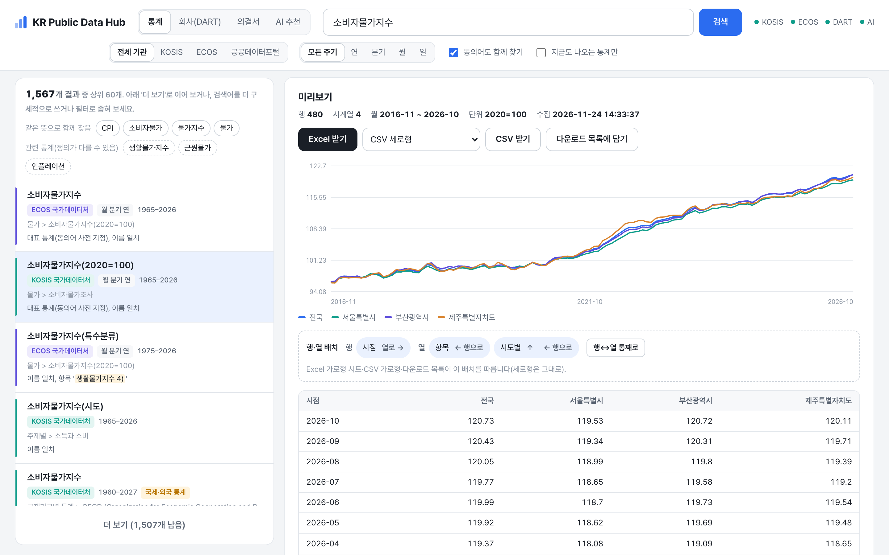
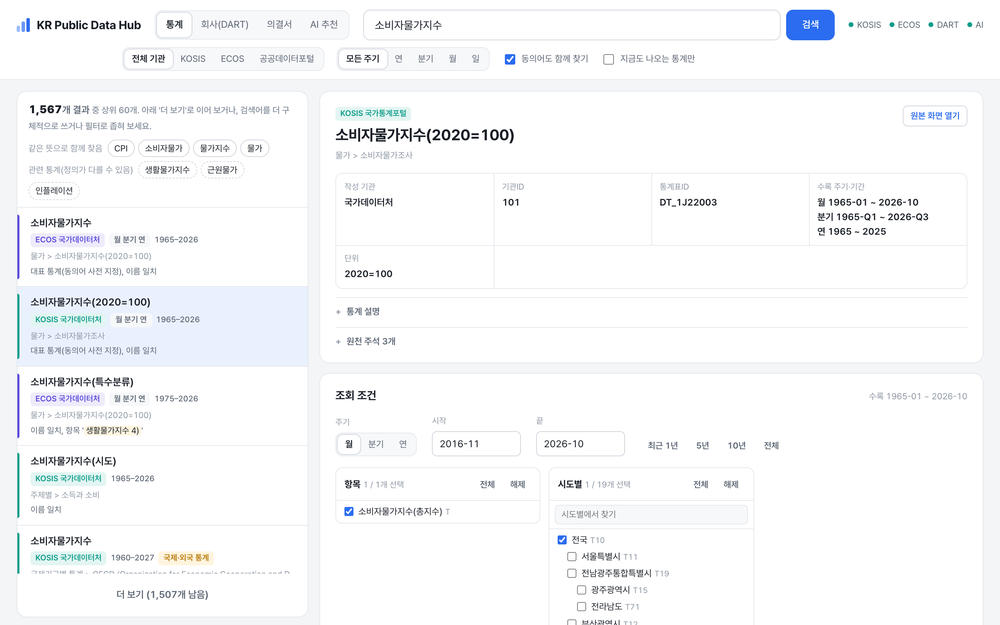
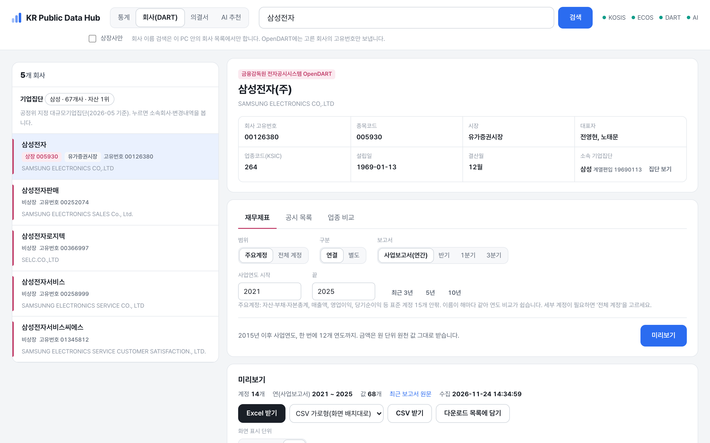
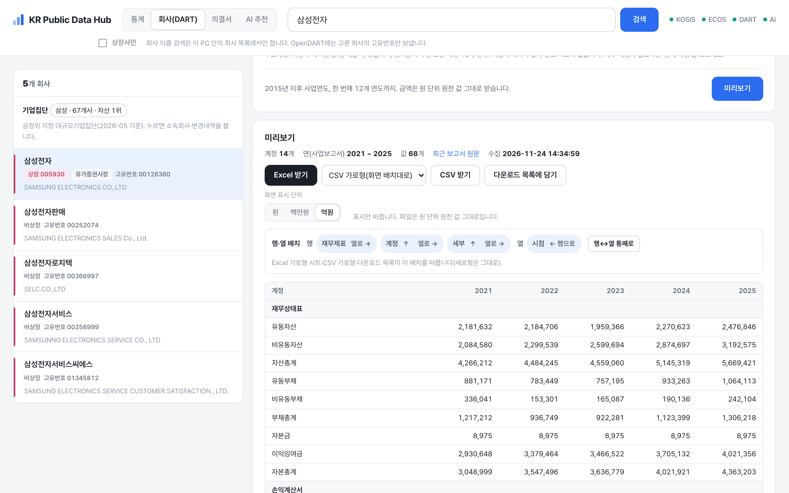
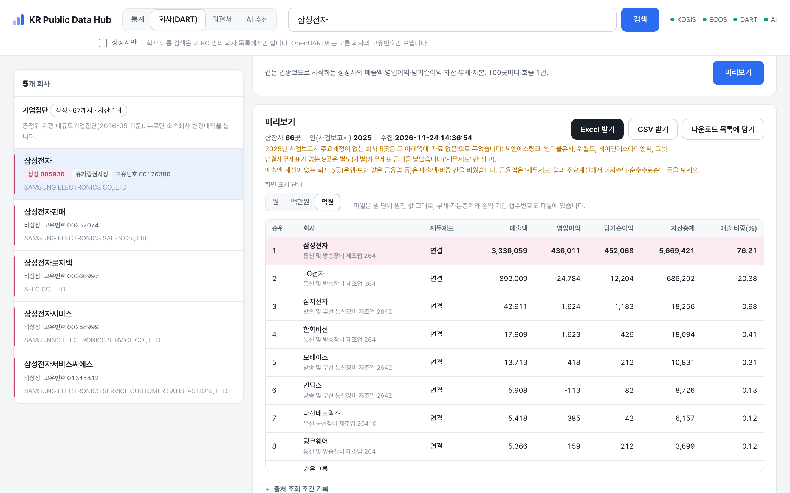
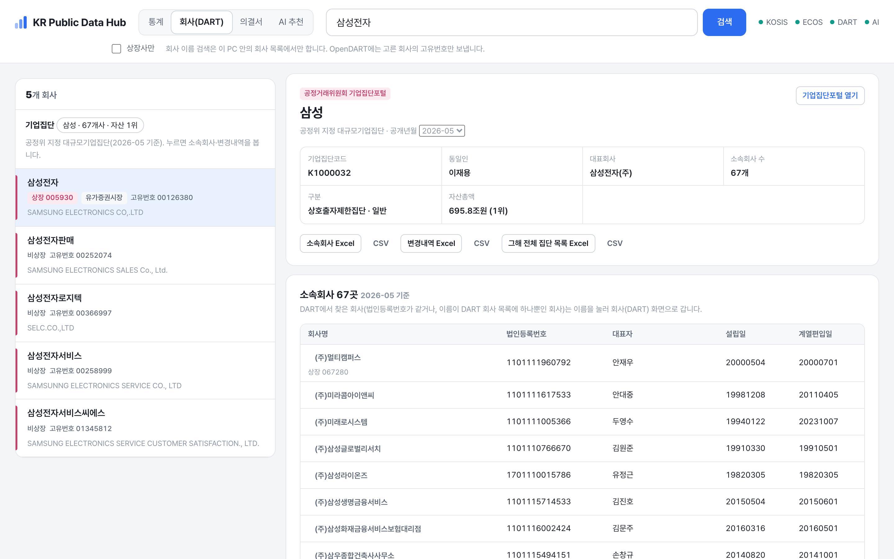
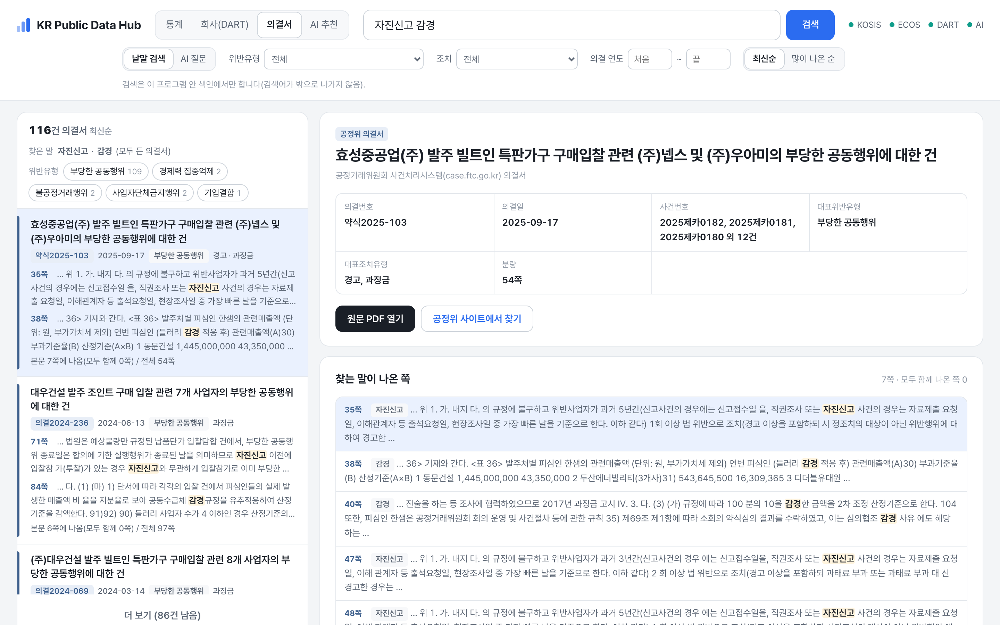
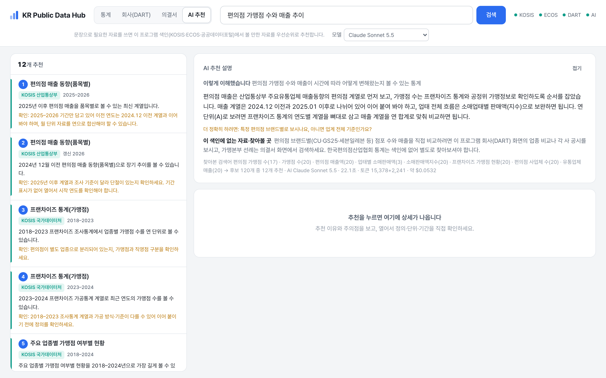
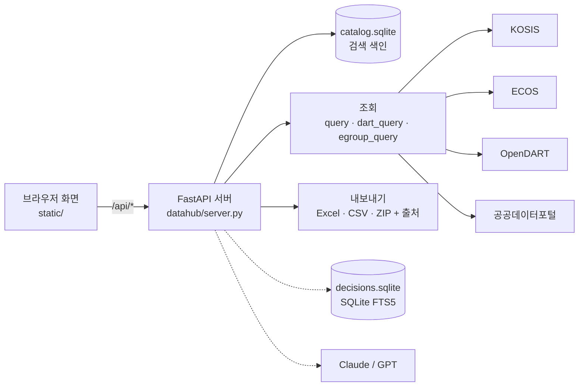

# KR Public Data Hub

한국 공공 경제데이터를 검색창 하나로 찾는 도구다. KOSIS(국가통계포털)와 한국은행 ECOS의 통계, OpenDART 공시, 공정위 기업집단포털, 공공데이터포털 목록을 색인해 두고, 표를 미리 본 뒤 출처 시트가 붙은 Excel·CSV로 받는다. 로컬에서 실행되며 각 기관 API는 사용자 키로 호출한다.

상태: 동작하는 프로토타입(v0.4), 로컬 전용(`127.0.0.1`), 사용자 계정 없음.

English: [README.md](README.md)



## 목적

한국의 경제분석, 특히 공정거래 사건 분석은 여러 공공 시스템에 흩어진 데이터를 쓴다. 시스템마다 사이트·코드 체계·조회 방식·호출 한도·오류 방식이 달라서, 맞는 표를 찾는 데 쓰는 시간이 분석보다 길어지기 쉽다. 이 도구는 출처들을 검색 하나, 미리보기 하나, 받기 형식 하나로 묶고, 숫자마다 어디서 왔는지 기록한다.

## 기능

| 영역 | 할 수 있는 것 |
| --- | --- |
| 통계 검색 | KOSIS 통계표 176,644개, ECOS 통계표 617개(항목×주기 59,096줄), 공공데이터포털 목록 103,114건을 한 번에 찾는다. 동의어 사전이 `CPI` 같은 말을 공식 이름으로 잇고, 이름은 비슷하지만 정의가 다른 통계는 따로 보여 준다. |
| 미리보기·받기 | 기간·항목을 골라 그래프와 표로 미리 보고, 행·열 배치를 바꾸고(KOSIS 행렬전환과 같음), Excel·CSV 또는 여러 표를 ZIP으로 받는다. 파일마다 출처·통계표 ID·조회 조건·API 주소(키는 가림)·수집 시각이 들어간다. |
| 회사(OpenDART) | 회사 약 12만 개를 찾아 기업개황, 주요계정·전체 계정 재무제표(2015년~, 연결·별도, 연간·분기), 공시 목록, 같은 업종코드(KSIC) 상장사 전체 비교표를 본다. |
| 기업집단 | 공정위 지정 대규모기업집단을 공개년월 29개(1997~2026-05)로 본다. 소속회사, 자산총액·순위, 편입·제외 이력. 소속회사는 법인등록번호로 OpenDART 회사 화면과 이어진다. |
| 공정위 의결서(선택) | 의결서 20,323건(208,548쪽) 본문을 AND·구절·빼기로 찾고, 위반유형·조치·연도로 거르고, 찾는 말이 나온 쪽을 본다. 따로 만든 색인이 있어야 한다. |
| AI 보조(선택) | 필요한 자료를 문장으로 쓰면 Claude나 GPT가 로컬 색인 안에서만 후보를 고르고 확인할 점을 붙인다. 의결서 질문은 찾아 온 쪽(최대 20쪽)만 보고 답하며 문장마다 근거 쪽을 단다. |

| | |
| --- | --- |
|  |  |
| KOSIS·ECOS·공공데이터포털 통합 검색 | 기업개황과 소속 기업집단 |
|  |  |
| 연도별 재무제표 | 같은 업종 상장사 비교 |
|  |  |
| 기업집단 소속회사 | 공정위 의결서 본문 검색 |



## 동작 방식



1. **색인.** `datahub.build_catalog`가 출처마다 표 목록(이름·경로·기간·항목)을 한 번 받아 `data/catalog.sqlite`에 넣는다. 통계 값은 저장하지 않는다.
2. **검색.** 로컬 색인에서 `data/synonyms.csv`로 넓혀 찾는다. 색인에 없는 표는 KOSIS 통합검색을 그때 불러 채운다.
3. **조회.** 미리보기·받기는 그 순간 기관 API를 부른다. 값은 받은 그대로 둔다. CSV는 글자 그대로, Excel은 안전한 경우만 숫자 칸(유효숫자 15자리 초과는 글자), 빈 값은 빈칸.
4. **내보내기.** 파일마다 조회 기록이 붙는다. API 키는 주소와 오류 메시지에서 지운 뒤에 쓰거나 보여 준다.

회사 이름 검색과 의결서 검색은 로컬 데이터에서만 한다. OpenDART에는 고른 회사의 고유번호·연도·보고서 종류만 간다. 통계 검색어는 KOSIS 통합검색으로도 간다. AI 기능은 질문과 후보 목록(의결서는 고른 쪽 본문)을 Anthropic이나 OpenAI로 보낸다. 의결서 원문 PDF를 열면 case.ftc.go.kr에서 그 한 건을 받는다.

### 기관 API 특성과 처리

| 출처 | 특성 | 처리 |
| --- | --- | --- |
| ECOS | 3분에 300회를 넘으면 키가 30분 막힘 | 180초에 240회로 제한 |
| ECOS | '전체' 조회 때 `list_total_count`를 부풀려 알림(13이라 하고 9행) | 한 번 더 요청, 그래도 모자라면 경고 |
| KOSIS | 항목 코드의 `*`를 `%2A`로 보내면 오류 21 | 주소를 직접 조립해 `*`·`+`를 그대로 보냄 |
| OpenDART | 계정 ID가 해마다 바뀜(삼성전자 5년, ID 기준 189줄 중 66줄만 연속) | 정규화한 계정 이름으로 먼저 잇고, 그 표에서 유일한 ID로만 보조 |
| OpenDART | 업종코드가 KSIC 제11차라 제10차 이름은 틀림(제10차 108 = 동물용 사료) | KOSIS 제11차 분류표 이름 사용 |
| OpenDART | 상장폐지 회사에도 종목코드가 남음(4,016곳 중 1,248곳) | 상장사 = 종목코드 + 법인구분 Y/K/N |
| 기업집단포털 | 소속회사 이름이 DART 이름과 다를 때가 있음 | 법인등록번호로 잇고, 이름은 하나뿐일 때만 |
| 공통 | 오류 메시지에 API 키가 되돌아올 수 있음 | 원문·URL 인코딩형 키를 기록 전에 가림 |
| 공공데이터포털 | 일부 파일은 보안 확인(캡차)을 요구 | 받지 않고 원본 페이지로 안내 |

## 시작하기

필요한 것: Python 3.10 이상, 쓰려는 출처의 API 키(무료).

```sh
git clone https://github.com/hyeokyun-kr/kr-public-data-hub.git
cd kr-public-data-hub
python3 -m pip install -r requirements.txt
cp .env.example .env        # .env에 키 붙여 넣기
```

| 키 | 받는 곳 | 쓰는 기능 |
| --- | --- | --- |
| `KOSIS_API_KEY` | [kosis.kr/openapi](https://kosis.kr/openapi/) | KOSIS 색인·조회 |
| `ECOS_API_KEY` | [ecos.bok.or.kr/api](https://ecos.bok.or.kr/api/) | ECOS 색인·조회 |
| `OPENDART_API_KEY` | [opendart.fss.or.kr](https://opendart.fss.or.kr) | 회사·재무제표·공시 |
| `DATA_GO_KR_SERVICE_KEY` | [data.go.kr](https://www.data.go.kr) (공정위 기업집단포털 API 활용신청) | 기업집단 |
| `ANTHROPIC_API_KEY`, `OPENAI_API_KEY` | Anthropic, OpenAI | AI 보조(선택) |

환경변수가 `.env`보다 먼저다. `.env`는 `.gitignore`에 들어 있다. 키가 없으면 그 키를 쓰는 기능만 꺼진다.

색인을 만들고 서버를 켠다.

```sh
python3 -m datahub.build_catalog --only ecos            # ECOS 통계표·항목, 약 7분
python3 -m datahub.build_catalog --only kosis --max-calls 16000   # KOSIS 목록, 약 1시간 40분
python3 -m datahub.build_catalog --only datago          # 공공데이터포털 목록(CSV 약 150MB)
python3 -m datahub.build_catalog --only dart            # OpenDART 회사 목록(호출 1회)
python3 -m datahub.build_catalog --only dart-industry   # 상장사 업종코드, 약 15분
python3 -m datahub.build_catalog --only egroup          # 기업집단, 호출 약 130회
python3 -m datahub.server                               # http://127.0.0.1:8765
```

KOSIS 기본 상한(`--max-calls 8000`, 약 50분)이면 통계표 약 9만 개가 들어간다. 위의 176,644개는 16,000회로 만든 것이다.

`run_mac.command`·`run_windows.bat`은 패키지를 설치하고, 처음 켤 때 ECOS·KOSIS 색인을 만든 뒤(약 1시간) 브라우저를 연다.

**의결서 탭.** 의결서 색인은 저장소에 없다. `tests/test_decisions.py`의 `SCHEMA`와 같은 구조의 SQLite 파일을 `DATAHUB_DECISION_DB`로 알려 주거나 `data/decisions.sqlite`에 둔다. 없으면 그 탭에 안내만 나오고 나머지는 그대로 된다.

테스트는 네트워크 없이 돈다.

```sh
python3 -m pip install pytest
python3 -m pytest -q        # 87개
```

사용법 전체는 [docs/USER_GUIDE.md](docs/USER_GUIDE.md).

## 검증

점검마다 이 도구의 코드를 쓰지 않고 기관 API를 직접 불러 값을 글자 그대로 비교했다. '독립'은 코드를 쓰지 않은 별도 코딩 에이전트(OpenAI Codex)가 지시문만 받고 한 회차, '작성자'는 만든 사람의 스크립트로 한 점검이다.

| 영역 | 점검 | 누가 | 결과 |
| --- | --- | --- | --- |
| KOSIS·ECOS | 3회에 걸쳐 값 44,749 + 18,362 + 17,243개 | 독립 | 불일치 0 |
| KOSIS·ECOS | 소비자물가지수 2020-01~2026-10을 두 출처에서 | 독립 | 두 출처 값이 같고, 각각 원천과 같음 |
| KOSIS·ECOS | 실제 검색어 40개 | 작성자 | 찾던 표가 1위 38개, 5위 안 40개 |
| OpenDART | 재무제표 12개 회사 × 336개 조건 | 독립 | 값 43,591개, 불일치 0 |
| OpenDART | 회사 검색 277쌍, 업종 비교 금액 762칸·비중 127칸, KSIC 업종명 2,001개 | 독립 | 불일치 0 |
| OpenDART | 전체 계정 연도 잇기 12,165개 연도 쌍 | 독립 | 규칙 위반 0 |
| 공공데이터포털 | 목록 검색, 받은 파일과 포털 원본 비교(2회) | 독립 | 검색 재현율 100%, 파일 바이트 일치 |
| 키 | 독립 회차의 모든 결과 파일·기록에서 실제 키 문자열(원문·URL 인코딩형) 찾기 | 독립 | 0건 |
| 의결서 | 질문 8개를 208,548쪽 전체 정규식 탐색과 비교 | 작성자 | 나와야 할 의결서 8,480건: 놓침 0, 더 나옴 0 |
| 의결서 | 찾는 말이 나온 쪽 목록, 의결서 1,006건 | 작성자 | 모두 정규식 탐색과 같음 |
| 의결서 AI 답 | 문장 98개를 근거 쪽과 대조 | 별도 검토 에이전트 | 근거 있음 91, 일부 6, 틀림 1. 숫자 135개 모두 근거 쪽에 있음 |

독립 1~10회에서 결함 23건을 찾았다(오류 분류, 부풀린 건수, 대소문자 섞인 인코딩의 키 가림, 연도 잇기 전이 등). 모두 고쳤고, 통계와 OpenDART의 마지막 회차에서는 새 결함이 없었다.

모델별로 근거와 맞은 문장: GPT-6.1 Sol 21/21, GPT-6.1 Terra 21/21, Claude Sonnet 5.5 23/25, Claude Haiku 5.5 26/31. Haiku는 각주에 인용된 다른 사건을 그 사건처럼 쓰는 오류가 반복돼 의결서 질문에서 뺐다.

점검은 그때그때의 판에서 했다. 통계는 v0.1, OpenDART·공공데이터포털은 v0.2, 의결서는 v0.4. 공개용 정리(이름, 키 설정, 파일 이름)는 그 뒤에 했고, 정리한 코드에서도 오프라인 테스트 87개가 통과했으며 위 화면도 정리한 코드로 찍었다.

## 한계

- 값 대조는 표본이다. KOSIS 통계표 176,644개를 모두 비교한 것은 아니다.
- KOSIS 색인은 호출 상한에서 멈췄고 깊은 폴더 8,255개는 받지 않았다. 검색할 때 KOSIS 통합검색으로 빈 곳을 채운다.
- KOSIS 표 대부분은 한 번 열어 보기 전에는 주기를 모른다.
- 전체 계정의 연도 잇기는 이름과 ID를 따르며 회계적 실질은 판단하지 않는다. 연도 비교는 주요계정을 쓴다.
- 업종 비교의 비중은 상장사 전체 매출 합계 대비 비율이며 관련시장 점유율이 아니다.
- 만료된 키, 호출 한도 응답, 기관이 키를 되돌려 주는 경우는 모의 응답으로만 시험했다.
- 의결서 검색은 붙여 쓴 긴 말 가운데의 낱말을 놓친다(시험 낱말 12개 재현율 99.83%).
- 의결서 AI 평가는 질문 3개로 했다. 그 뒤 더한 답 규칙은 Haiku로만 다시 쟀다.
- AI 추천, 기업집단, 행·열 배치, 의결서 탭, 공공데이터포털 마지막 수정 3건은 독립 회차를 거치지 않았다. 만든 사람의 테스트와 스크립트로 확인했다.
- `run_windows.bat`은 Windows에서 돌려 보지 않았다.

## 변경 이력

### 2026-11-26
- 고침: 켤 때 OpenDART 회사 목록 주간 갱신이 같은 색인 파일에 쓰는 중이면 검색 색인이 '불러오는 중'에서 멈출 수 있었음. 이제 다시 시도하고, 실패하면 상태에 오류를 보여 줌.

### 2026-11-24
- 공개판: 이름을 KR Public Data Hub로 바꿈, 키는 환경변수·`.env`에서만 읽음, 의결서 탭을 선택 기능으로, 영문·국문 README, 화면 캡처.

### 2026-11-17 (v0.4)
- 공정위 의결서 본문 검색, 근거 쪽을 다는 AI 질문.

### 2026-11-16 (v0.3)
- 공정위 기업집단포털, 법인등록번호로 OpenDART와 연결.
- 미리보기·받기의 행·열 배치.

### 2026-11-13 (v0.2)
- OpenDART: 회사 검색, 재무제표, 공시 목록, 업종 비교.
- 공공데이터포털 목록 검색과 원본 파일 받기. AI 추천.

### 2026-11-13 (v0.1)
- KOSIS·ECOS 색인, 동의어 검색, 미리보기, 출처가 붙은 Excel·CSV.

## 파일 구성

```
datahub/
  server.py            FastAPI 앱과 경로
  build_catalog.py     색인 만들기 (--only ecos|ecos-missing|kosis|dart|dart-industry|ksic|datago|egroup)
  catalog.py           검색 색인과 순위
  synonyms.py          동의어 사전
  query.py             KOSIS·ECOS 미리보기·받기
  dart_query.py        OpenDART 재무제표·공시·업종 비교
  egroup_query.py      기업집단
  datago_query.py      공공데이터포털 목록·파일
  decisions.py         공정위 의결서 검색(선택 색인)
  decision_ai.py       의결서 AI 질문
  ai_recommend.py      AI 자료 추천
  pivot.py             행·열 배치
  exporter.py          출처가 붙은 Excel·CSV·ZIP
  sources/             기관 API별 연결(호출 한도·오류)
static/                브라우저 화면(바닐라 JS)
data/synonyms.csv      동의어 사전(Excel로 고침)
data/ksic_names.csv    KSIC 제11차 업종명
tests/                 오프라인 테스트
docs/USER_GUIDE.md     사용설명서
```

## 데이터와 라이선스

이 저장소에는 기관 데이터가 들어 있지 않다(KOSIS에서 받은 KSIC 제11차 업종명 `data/ksic_names.csv`만 예외). 데이터는 각자의 키로 받으며 각 기관의 이용 조건을 따른다. 코드는 [MIT License](LICENSE).
