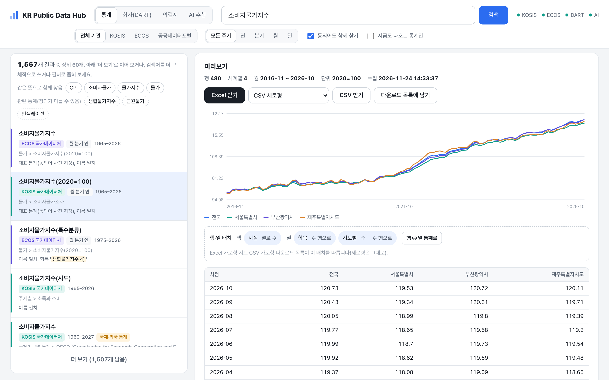
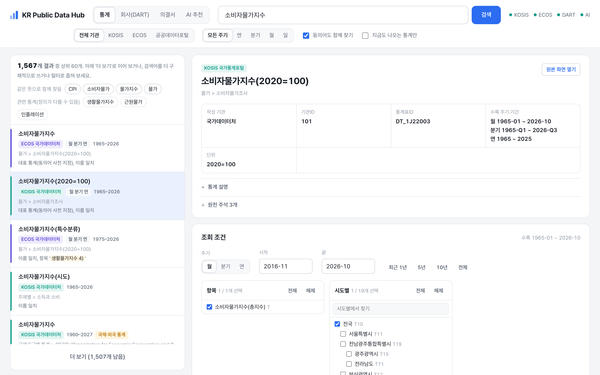
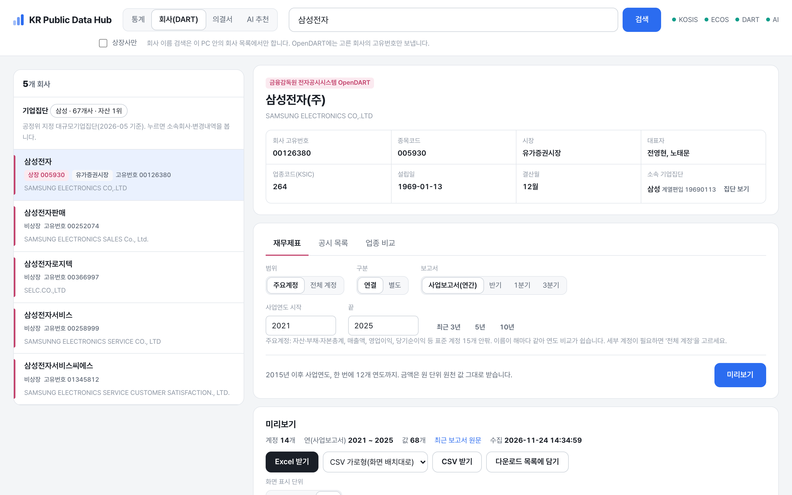
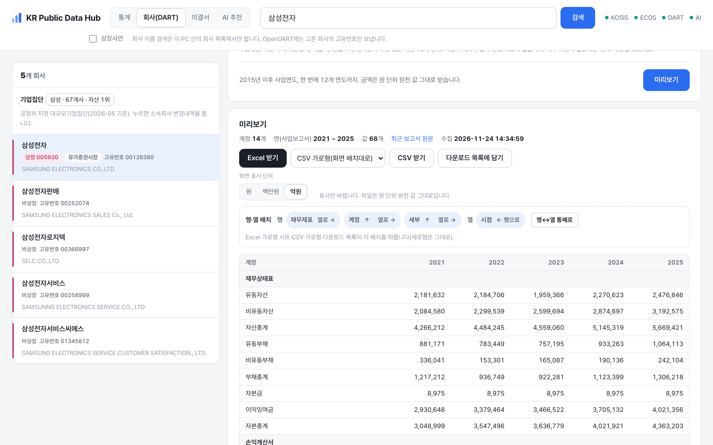
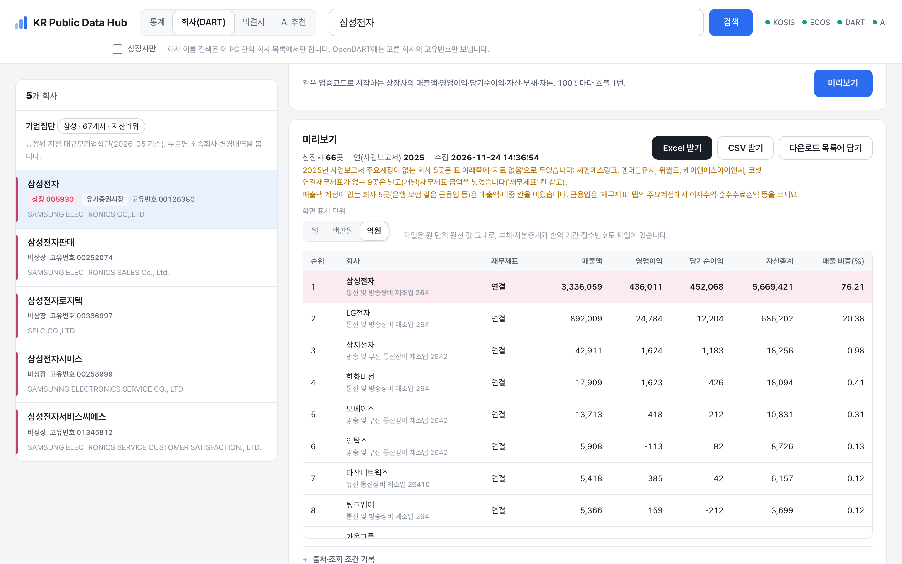
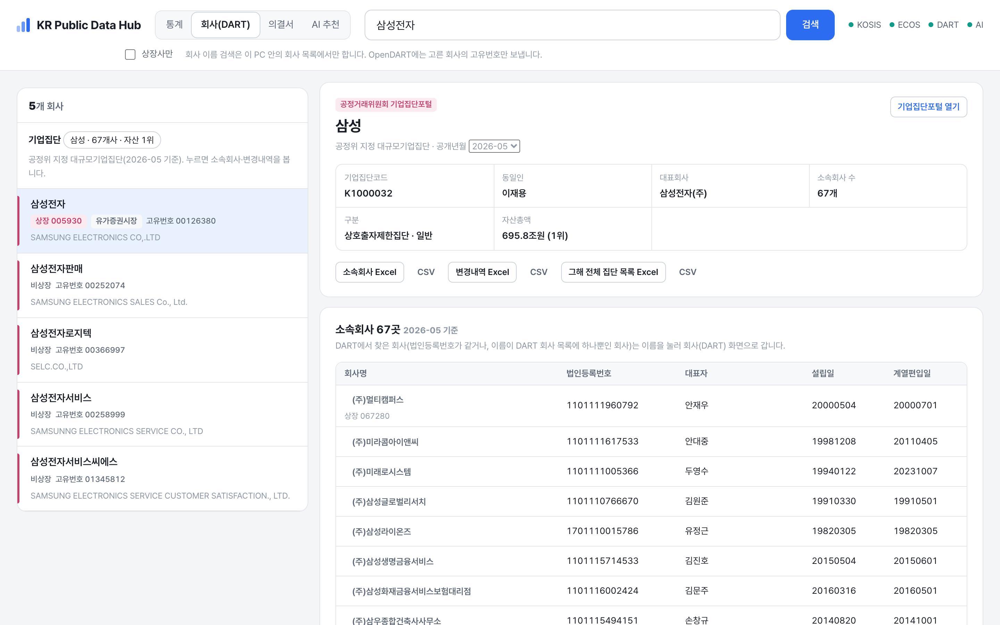
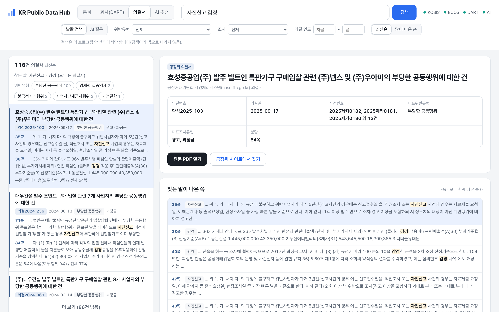
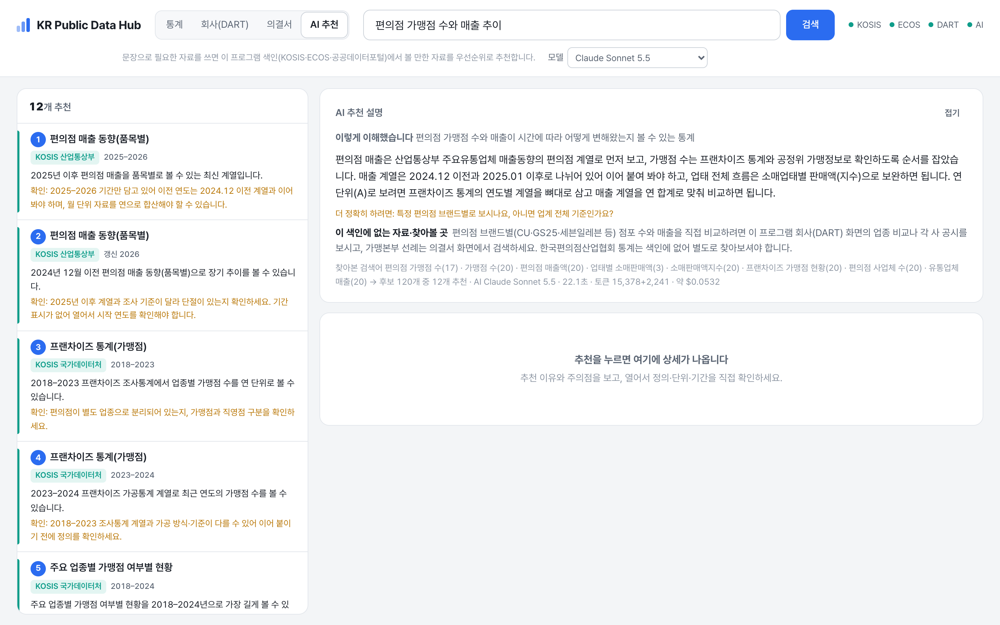
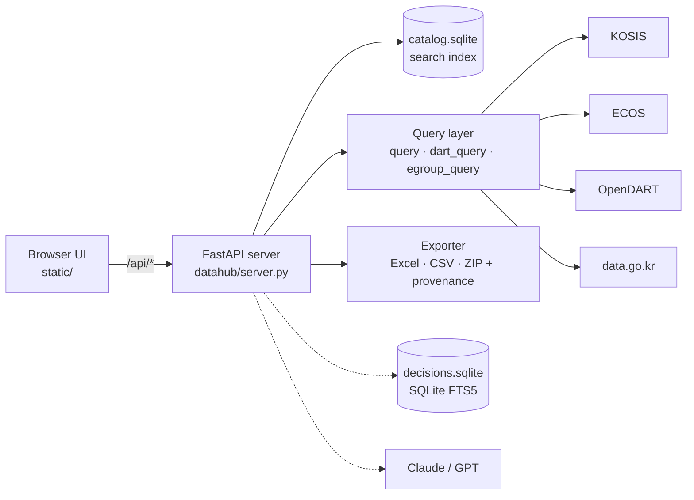

# KR Public Data Hub

One search box for Korean public economic data. KR Public Data Hub indexes statistics from KOSIS and the Bank of Korea (ECOS), company filings from OpenDART, the KFTC business group portal and the data.go.kr catalog, then lets you preview any table and download it as Excel or CSV with a provenance sheet. It runs locally and calls each source API with your own keys.

Status: working prototype (v0.4), local use only (`127.0.0.1`), no user accounts.

한국어: [README.ko.md](README.ko.md)



## Purpose

Economic analysis in Korea, competition cases in particular, draws on data spread over several public systems. Each has its own website, codes, query format, rate limits and error behaviour, so finding the right table often takes longer than using it. The hub puts these sources behind one search, one preview and one download format, and records where every number came from.

## Features

| Area | What you can do |
| --- | --- |
| Statistics search | Search 176,644 KOSIS tables, 617 ECOS tables (59,096 item × frequency rows) and 103,114 data.go.kr datasets at once. A synonym dictionary maps terms like `CPI` to the official name; related but differently defined series are shown separately. |
| Preview and download | Pick period and items, preview a chart and table, rearrange rows and columns (as in KOSIS), download Excel, CSV or a ZIP of several tables. Each file includes the source, table ID, query, API URL (key masked) and retrieval time. |
| Companies (OpenDART) | Search about 120,000 companies, view the company profile, key or full financial statements (2015 onward, consolidated or separate, annual or quarterly), filings list, and an industry table of all listed firms with the same KSIC code. |
| Business groups | KFTC-designated large business groups for 29 designation snapshots (1997 to 2026-05): affiliates, total assets and rank, entry and exit history. Affiliates link to their OpenDART profile by corporate registration number. |
| FTC decisions (optional) | Full-text search over 20,323 KFTC decisions (208,548 pages) with AND, phrases and exclusions, filters by violation type, remedy and year, and page-level hits. Requires a separately built index. |
| AI assistance (optional) | Describe the data you need in a sentence; Claude or GPT picks candidates from the local index only and explains what to check. For decisions, the model answers from at most 20 retrieved pages and cites each page. |

| | |
| --- | --- |
|  |  |
| Search across KOSIS, ECOS and data.go.kr | Company profile with business group link |
|  |  |
| Financial statements by year | Listed firms in the same KSIC industry |
|  |  |
| Business group affiliates | FTC decision full-text search |



## How it works



1. **Index.** `datahub.build_catalog` crawls each source's table list once (names, paths, periods, item lists) into `data/catalog.sqlite`. Statistical values are not stored.
2. **Search.** Queries run against the local index, expanded with `data/synonyms.csv`. KOSIS integrated search is called live to fill tables missing from the index.
3. **Query.** Preview and download call the source API at that moment. Values are kept as returned: CSV as text, Excel as numbers only where it is safe (more than 15 significant digits stays text), nulls stay empty.
4. **Export.** Every file carries the query record. API keys are removed from URLs and error messages before anything is written or shown.

Company name search and decision search run on local data only; OpenDART receives the selected company code, year and report type. Statistics search terms are also sent to KOSIS integrated search. AI features send the question and the candidate list, or the selected decision pages, to Anthropic or OpenAI. Opening an original decision PDF downloads it from case.ftc.go.kr.

### Source API behaviour handled

| Source | Behaviour | Handling |
| --- | --- | --- |
| ECOS | More than 300 calls in 3 minutes blocks the key for 30 minutes | Client-side limit of 240 calls per 180 s |
| ECOS | `list_total_count` overstated on "all items" queries (reported 13, returned 9) | Request once more; warn if rows are still missing |
| KOSIS | `*` in item codes sent as `%2A` returns error 21 | Query string built by hand, `*` and `+` kept literal |
| OpenDART | Account IDs change between years (Samsung Electronics, 5 years: 66 of 189 rows continuous by ID) | Link rows by normalized account name, then by an ID unique in that statement |
| OpenDART | Industry codes are KSIC revision 11; revision-10 names are wrong (108 = animal feed in rev. 10) | Names from the KOSIS revision-11 classification table |
| OpenDART | Stock codes remain on delisted companies (1,248 of 4,016) | Listed = stock code and market class Y/K/N |
| Business group portal | Affiliate names do not always match DART names | Link by corporate registration number; by name only when the name is unique |
| All | Error messages can echo the API key | Raw and URL-encoded key forms masked before logging |
| data.go.kr | Some file downloads require a captcha | Stop and link to the dataset page |

## Getting started

Requirements: Python 3.10+, API keys (free) for the sources you want to use.

```sh
git clone https://github.com/hyeokyun-kr/kr-public-data-hub.git
cd kr-public-data-hub
python3 -m pip install -r requirements.txt
cp .env.example .env        # paste your keys into .env
```

| Key | Where to get it | Needed for |
| --- | --- | --- |
| `KOSIS_API_KEY` | [kosis.kr/openapi](https://kosis.kr/openapi/) | KOSIS index and data |
| `ECOS_API_KEY` | [ecos.bok.or.kr/api](https://ecos.bok.or.kr/api/) | ECOS index and data |
| `OPENDART_API_KEY` | [opendart.fss.or.kr](https://opendart.fss.or.kr) | Companies, financial statements, filings |
| `DATA_GO_KR_SERVICE_KEY` | [data.go.kr](https://www.data.go.kr) (apply for the KFTC business group portal APIs) | Business groups |
| `ANTHROPIC_API_KEY`, `OPENAI_API_KEY` | Anthropic, OpenAI | AI assistance (optional) |

Environment variables take precedence over `.env`. `.env` is in `.gitignore`. A missing key disables only the features that need it.

Build the index, then start the server:

```sh
python3 -m datahub.build_catalog --only ecos            # ECOS tables and items, about 7 min
python3 -m datahub.build_catalog --only kosis --max-calls 16000   # KOSIS table tree, about 1 h 40 min
python3 -m datahub.build_catalog --only datago          # data.go.kr catalog (about 150 MB CSV)
python3 -m datahub.build_catalog --only dart            # OpenDART company list (1 call)
python3 -m datahub.build_catalog --only dart-industry   # industry codes of listed firms, about 15 min
python3 -m datahub.build_catalog --only egroup          # business groups, about 130 calls
python3 -m datahub.server                               # http://127.0.0.1:8765
```

The default KOSIS budget (`--max-calls 8000`, about 50 min) indexes about 90,000 tables; 16,000 calls gave the 176,644 above.

`run_mac.command` and `run_windows.bat` install packages, build the ECOS and KOSIS index on first run (about 1 hour) and open the browser.

**FTC decision tab.** The decision index is not included. Point `DATAHUB_DECISION_DB` to a SQLite file with the schema in `tests/test_decisions.py` (`SCHEMA`), or place it at `data/decisions.sqlite`. Without it the tab shows a notice and everything else works.

Full usage (Korean): [docs/USER_GUIDE.md](docs/USER_GUIDE.md).

Tests run offline:

```sh
python3 -m pip install pytest
python3 -m pytest -q        # 87 tests
```

## Verification

Each check called the source API directly, without the hub's code, and compared values as exact strings. "Independent" rounds were run by a separate coding agent (OpenAI Codex) that did not write the code and worked from written instructions. "Author" checks used the author's own scripts.

| Area | Check | By | Result |
| --- | --- | --- | --- |
| KOSIS / ECOS | 44,749 + 18,362 + 17,243 values in 3 rounds | Independent | 0 mismatches |
| KOSIS / ECOS | CPI 2020-01 to 2026-10 from both sources | Independent | Same values in both, each equal to its source |
| KOSIS / ECOS | 40 real search queries | Author | Target table ranked 1st in 38, top 5 in 40 |
| OpenDART | Financial statements, 12 companies × 336 conditions | Independent | 43,591 values, 0 mismatches |
| OpenDART | Company search 277 pairs; industry table 762 amounts and 127 shares; 2,001 KSIC names | Independent | 0 mismatches |
| OpenDART | Year linking of full accounts, 12,165 year pairs | Independent | 0 rule violations |
| data.go.kr | Catalog search; downloaded files vs. the portal (2 rounds) | Independent | Search recall 100%, files byte-identical |
| Keys | Real key strings (raw and URL-encoded) in all files and logs from the independent rounds | Independent | 0 found |
| FTC decisions | 8 queries against a regex scan of all 208,548 pages | Author | 8,480 expected decisions: 0 missed, 0 extra |
| FTC decisions | Pages listed as hits, 1,006 decisions | Author | All identical to the regex scan |
| AI answers on decisions | 98 statements checked against the cited pages | Separate reviewer agent | 91 supported, 6 partly, 1 wrong; 135 of 135 numbers found on the cited page |

Independent rounds 1 to 10 found 23 defects, among them error classification, overstated row counts, key masking with mixed-case encoding and chained year links. All were fixed; the final rounds for statistics and OpenDART found no new defects.

Statements supported, by model: GPT-6.1 Sol 21/21, GPT-6.1 Terra 21/21, Claude Sonnet 5.5 23/25, Claude Haiku 5.5 26/31. Haiku mixed up cases cited in footnotes, so it is not offered for decision questions.

Each check ran on the version current at the time: statistics on v0.1, OpenDART and data.go.kr on v0.2, decisions on v0.4. The public repackaging (name, key settings, file names) came after; the 87 offline tests pass on it, and the screenshots above were taken from it.

## Limitations

- Value checks are samples. Not every one of the 176,644 KOSIS tables was compared.
- The KOSIS index stops at a call budget; 8,255 deep folders were not crawled. Live KOSIS search fills gaps at query time.
- The frequency of most KOSIS tables is unknown until the table is opened once.
- Full-account year linking follows names and IDs, not accounting substance. Use key accounts for comparisons across years.
- The industry table's share is each firm's share of the listed firms' total revenue, not a relevant-market share.
- Expired keys, rate-limit responses and keys echoed by a source were tested with mocked responses only.
- Decision search misses words written without spaces inside longer compounds (recall 99.83% on 12 test words).
- The AI decision evaluation used 3 questions. Prompt rules added afterwards were re-measured only for Haiku.
- AI recommendation, business groups, the row and column layout, the decision tab and the last three data.go.kr fixes had no independent round. They were checked with the author's tests and scripts.
- `run_windows.bat` has not been run on Windows.

## Changelog

### 2026-11-26
- Fix: the search index could stay on "loading" forever when the weekly OpenDART company-list refresh was writing to the same file at startup. Loading now retries and the status shows the error.

### 2026-11-24
- Public release: renamed to KR Public Data Hub, keys read only from environment variables or `.env`, decision tab made optional, English and Korean README, screenshots.

### 2026-11-17 (v0.4)
- FTC decision full-text search and AI questions with page citations.

### 2026-11-16 (v0.3)
- KFTC business group portal, linked to OpenDART by corporate registration number.
- Row and column layout for previews and downloads.

### 2026-11-13 (v0.2)
- OpenDART: company search, financial statements, filings, industry table.
- data.go.kr catalog search and original file download. AI recommendation.

### 2026-11-13 (v0.1)
- KOSIS and ECOS index, search with synonyms, preview, Excel and CSV with provenance.

## Files

```
datahub/
  server.py            FastAPI app and routes
  build_catalog.py     index builder (--only ecos|ecos-missing|kosis|dart|dart-industry|ksic|datago|egroup)
  catalog.py           search index and ranking
  synonyms.py          synonym dictionary
  query.py             KOSIS / ECOS preview and download
  dart_query.py        OpenDART statements, filings, industry table
  egroup_query.py      business groups
  datago_query.py      data.go.kr catalog and files
  decisions.py         FTC decision search (optional index)
  decision_ai.py       AI questions on decisions
  ai_recommend.py      AI data recommendation
  pivot.py             row / column layout
  exporter.py          Excel, CSV, ZIP with provenance
  sources/             one client per source API (rate limits, errors)
static/                browser UI (vanilla JS)
data/synonyms.csv      synonym dictionary (edit in Excel)
data/ksic_names.csv    KSIC revision-11 names
tests/                 offline tests
docs/USER_GUIDE.md     user guide (Korean)
```

## Data and license

This repository contains no data from the sources, except `data/ksic_names.csv` (KSIC revision-11 names from KOSIS). Data is fetched with your own keys and is subject to each provider's terms. Code is under the [MIT License](LICENSE).
